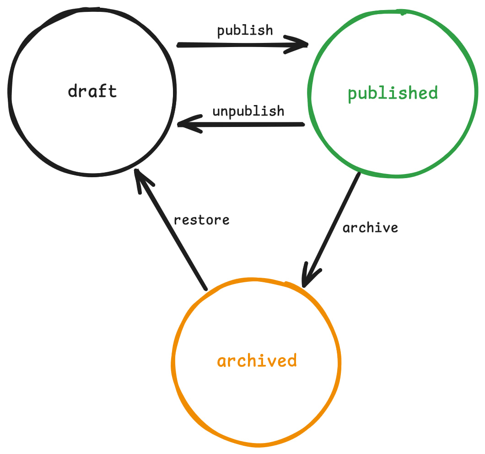

#state_machine #cs #FSM #DFA #NFA #turing_machine

# State Machine

State machine is something that's in exactly one state at a time, and move between states in response to events/inputs according to defined rules.  
  
For example, blog post status, post status is a state machine, because it has set of states and can move between those states: `draft`, `published`, `archived`; draft post can be published; published post can be unpublished or archived; archived post can be restored:

```
draft ──► published ──► archived
  ▲           │             │
  └───────────┘             │
  └─────────────────────────┘

```

Did you notice something? Yes, finite state machines are also directed graphs: where states are vertices and moves between them are edges (img 1.)

img 1. directed graph of post's status

Also we can represent it as a transition table:

post's status transition table

|Current State|Event/Input|Next State|
|---|---|---|
|draft|publish|published|
|published|unpublish|draft|
|published|archive|archived|
|archived|restore|draft|

Why is this concept is important? This makes imposible to make invalid transitions, like archived -> published directly, and that's the whole point of modeling it this way.

This is pseudo C code example:

```
typedef enum { DRAFT, PUBLISHED, ARCHIVED } State;
typedef enum { PUBLISH, UNPUBLISH, ARCHIVE, RESTORE } Event;

State next_state(State current, Event event) {
    switch (current) {
    case DRAFT:
        if (event == PUBLISH)   return PUBLISHED;
        break;
    case PUBLISHED:
        if (event == UNPUBLISH) return DRAFT;
        if (event == ARCHIVE)   return ARCHIVED;
        break;
    case ARCHIVED:
        if (event == RESTORE)   return DRAFT;
        break;
    }
    return current;   // invalid event: stay in the same state
}
```

Here we have our finite set of states, and fixed number of events and transition rule in `next_state` function.

```
handle(PUBLISH);     // draft -> published
handle(ARCHIVE);     // published -> archived
handle(PUBLISH);     // invalid: archived posts can't be published directly
handle(RESTORE);     // archived -> draft
```

As you can see `handle(PUBLISH)` after `handle(ARCHIVE)` is invalid, because based on our rules this transition from `archived` -> `published` is imposible.

## Types

There are two types based on set of states: finite and infinite.

### Infinite State Machine (ISM)

An Infinite one has unbounded number of possible states or infinite number of memory given to a machine. But how? These are abstract or imaginary machines that don't exist.

### Finite State Machine (FSM)

Finite has fixed number of states. Example above is also a finite state machine, which has only three possible states: draft, published, and archived.

Another example, a simple traffic light. It has three states: `green`, `yellow`, `red`. But this time event is timer tick.  

traffic light transition table

|Current State|Event/Input|Next State|
|---|---|---|
|green|timer|yellow|
|yellow|timer|red|
|red|timer|green|

## Turing Machine

[Turing machine](https://en.wikipedia.org/wiki/Turing_machine) is neither ISM, nor FSM, but something both of them: this abstract machine has finite number of states and infinite tape (memory). It was invented in 1936 by [Alan Turing](https://en.wikipedia.org/wiki/Alan_Turing), who called it an "a-machine" (automatic machine).

### Real Computers

Actually our computers are factually finite state machines. A physical computer has a finite number of bits (registers, RAM, disk), so it has a finite number of possible states. But why don't we treat it as an FSM in practice? For example, assume we have 16 GB of RAM, with that we have about 1.4 × 10¹¹ bits, which is roughly 2^(137,000,000,000) states. We can’t draw that diagram, enumerate it, or run a state-minimization algorithm on it. The model is technically correct but useless for reasoning about programs. So we pretend memory is unbounded and use the Turing machine model instead. A Turing machine has a finite number of states in its control unit, plus an infinite tape. So real computers are best seen as Turing machines with a very large but finite tape.

In conclusion, real computers are finite state machines, but their state space is so large that we model them as infinite ones.

## Determinism

A further distinction is between _deterministic_ ([DFA](https://en.wikipedia.org/wiki/Deterministic_finite_automaton)) and _non-deterministic_ ([NFA](https://en.wikipedia.org/wiki/Nondeterministic_finite_automaton), [GNFA](https://en.wikipedia.org/wiki/Generalized_nondeterministic_finite_automaton)) state machines (or they can also be called automata.  
In a **deterministic** FSM (DFA) every (state, input) pair leads to exactly one next state. Given the current state and the input, there’s never a choice. Blog post machine is deterministic: `published` + `archive` always gives `archived`.

In a **non-deterministic** FSM (NFA), a (state, input) pair can lead to several next states, or to none.

---

Useful links

- [https://developer.mozilla.org/en-US/docs/Glossary/State_machine](https://developer.mozilla.org/en-US/docs/Glossary/State_machine) _(short explanation)_
- [https://discretemath.org/ads/s-automata-finite-state-machines.html#ex-vending-machine](https://discretemath.org/ads/s-automata-finite-state-machines.html#ex-vending-machine) _(math involved)_
- [https://howtomakeanrpg.com/r/a/state-machines.html](https://howtomakeanrpg.com/r/a/state-machines.html) _(mostly about game side of software but also interesting)_
- [https://en.wikipedia.org/wiki/Finite-state_machine](https://en.wikipedia.org/wiki/Finite-state_machine)
- [https://en.wikipedia.org/wiki/Turing_machine](https://en.wikipedia.org/wiki/Turing_machine)
- [https://en.wikipedia.org/wiki/Deterministic_finite_automaton](https://en.wikipedia.org/wiki/Deterministic_finite_automaton)
- [https://en.wikipedia.org/wiki/Nondeterministic_finite_automaton](https://en.wikipedia.org/wiki/Nondeterministic_finite_automaton)
